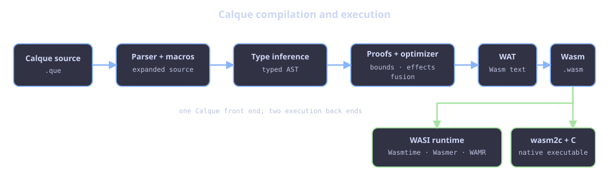

# WebAssembly target

Calque lowers its typed AST into WebAssembly. Core scalar values fit the Wasm
`i32` model: `Int`, `Bool`, `Char`, enum tags, `Dec`, and unit all have compact
scalar lowering. Managed collections and closures use the runtime’s reference
counted representation.



## Wasm32 today

The default target is Wasm32: linear-memory addresses and array indexes in the
runtime are `i32`. An `Int` index is signed at the language level, while Wasm
memory addressing is unsigned internally; valid program indices are therefore
non-negative and bounded by the allocated vector length.

Wasm32’s address space is bounded by its configured linear memory limits. This
does not make the language architecture obsolete: Wasm continues to support
`i32` operations on 64-bit hosts, and memory64 can be introduced later with an
explicit wider language type rather than changing existing `Int` behavior.

## Inspect generated output

```sh
que program.que --emit source --out expanded.que
que program.que --opt --emit opt-source --out optimized.que
que program.que --opt --emit wat --out program.wat
que program.que --opt --emit wasm --out program.wasm
```

Use this when optimizing or reporting a compiler bug. The expanded source
shows macro lowering; optimized source shows source-level rewrites; WAT shows
the final Wasm structure.

## Runtime choices

`que program.que` compiles then invokes an external WASI runtime. Wasmtime is
the default runtime; Wasmer and iwasm/WAMR can also be selected.

The repository’s native path runs generated Wasm through `wasm2c` and a C
compiler. It is deliberately separate from the main `que` command:

```sh
./scripts/compile-native-c.sh program.que
```

This is useful for completed compute-heavy programs and native benchmarking.
It is not a different source language: static typing, macro expansion, and
Wasm generation occur first in the same compiler.

For the debug/optimized safety boundary and a release checklist, see [Debug,
optimized, and native execution](release-safety.md).
