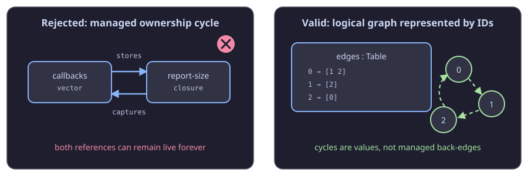

# Memory management and ownership

Calque has no tracing garbage collector. Managed values use runtime reference
counting: the compiler inserts retains, releases, and ownership transfers for
you. There is no `free`, borrow annotation, lifetime syntax, or manual retain
operation in ordinary Calque source.

This is designed to make memory behavior predictable: when the final live
reference to a managed value is released, its storage can be reclaimed
immediately by the runtime allocator. The optimizer can also transfer a fresh
value directly to its final owner, or release a value after its last use, which
avoids needless retain/release traffic.

## What is managed

`Int`, `Dec`, `Bool`, `Char`, unit, and enum tags are immediate `i32` values.
They do not allocate and do not participate in reference counting.

Vectors, strings (`[Char]`), tuples containing managed values, and closures
are managed heap values. The rule is implementation detail, not an operation
you normally need to write around:

```que
(let title "Calque")             ; a managed character vector
(let pair {title [1 2 3]})       ; managed tuple containing managed vectors
(let prefix (lambda (x)          ; managed closure: it captures title
  (cons title x)))

(prefix " is typed")
```

Aliasing is safe. If two bindings refer to the same vector, it remains alive
until neither binding (nor any live container or closure) owns it:

```que
(let xs [1 2 3])
(let also-xs xs)
(length also-xs)
```

You should write the direct program. Calque determines when a retain is
needed, when a value can be moved instead, and when it can be released.

## Why cycles are forbidden

Reference counting alone cannot reclaim a cycle. If a vector owns a closure
and that closure captures the same vector, both counts can remain nonzero even
after the surrounding program has stopped referring to either one.

Calque therefore rejects source-level operations that would form a managed
reference cycle. This program is rejected at compile time:

```que
(let callbacks [])
(let report-size
  (lambda ()
    (length callbacks)))

; Error: report-size captures callbacks, then is stored in callbacks.
(push! report-size callbacks)
```



The same protection applies to direct `set!` and recognised container
mutators—such as table, set, heap, and deque operations—and also follows a
simple wrapper function that stores one of its arguments into another. The
diagnostic identifies the storing operation and the captured managed root.

Capturing a collection is fine by itself. It is the *back-edge*—putting that
capturing closure into the collection it captures—that is not allowed:

```que
(let xs [1 2 3])
(let size
  (lambda ()
    (length xs)))

(size)
; 3 — no cycle: xs does not own size.
```

This restriction is intentional. Calque does not promise a cycle collector as
a fallback, because that would lose deterministic reclamation and introduce a
second memory-management model.

## Model graphs with IDs, not object back-edges

Cycles in the *data you model* are perfectly valid. Represent graph edges with
integers, strings, enum tags, or table keys rather than managed pointers or
closures that refer back to their owner:

```que
; Node id -> ids of outgoing neighbours.
(let edges (Table/new))
(Table/set! 0 [1 2] edges)
(Table/set! 1 [2] edges)
(Table/set! 2 [0] edges)
```

That graph has a logical cycle (`0 → 1 → 2 → 0`), but its values do not own one
another. It is ordinary acyclic runtime storage and works with the graph
helpers in the standard library.

For parent links, caches, registries, or callback dispatch, use an ID or a key
into an owner table instead of storing a closure back into the structure that
closure captures.

## Mutation, capacity, and observable memory

`empty!` removes vector elements. If those elements are managed, their owned
references are released; the vector's backing allocation is retained for
reuse. `capacity!` reserves backing storage and `compact!` rebuilds a vector
with only the storage required by its current length:

```que
(let work [])
(capacity! 1000 work)
; fill and process work
(empty! work)       ; elements are released; reserved storage stays reusable
(compact! work)     ; discard unused backing capacity
```

Releasing an object returns it to Calque's allocator. It does **not** guarantee
that a WebAssembly runtime immediately returns linear-memory pages to the
operating system, so RSS may remain high after a temporary peak. The important
semantic guarantee is that unreachable managed objects do not remain live;
their storage is available for reuse without a tracing-GC pause.

## Performance and external hosts

Reference counting has a cost when a managed value is shared. Calque's
optimizer removes redundant retain/release pairs, transfers ownership of fresh
values, and specializes known vector paths where it can. Use `que explain
program.que --opt` when investigating retained/released work in a hot path.

`--debug` and `--opt` use the same ownership semantics. Debug mode adds safety
guards; optimized mode may remove proven-safe checks and redundant ownership
traffic, but it never makes cycles valid.

The rule also matters at FFI boundaries. A custom Wasm host that constructs or
retains Calque-managed values must obey the runtime ownership convention. Do
not use a host import to manufacture a cyclic Calque object; it bypasses the
source-level proof that keeps ordinary programs cycle-free. See [FFI and host
imports](../compiler/ffi.md) for the ABI boundary.
